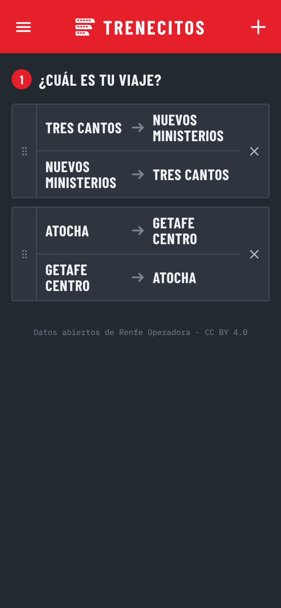
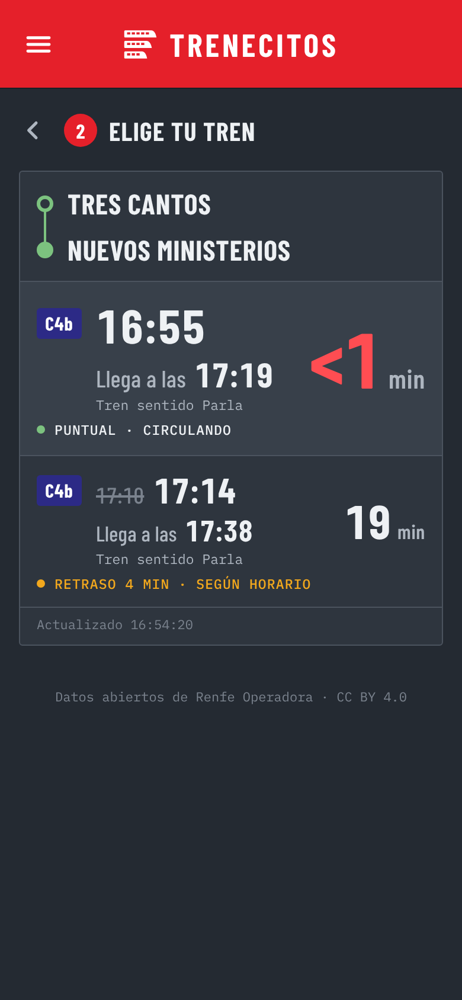
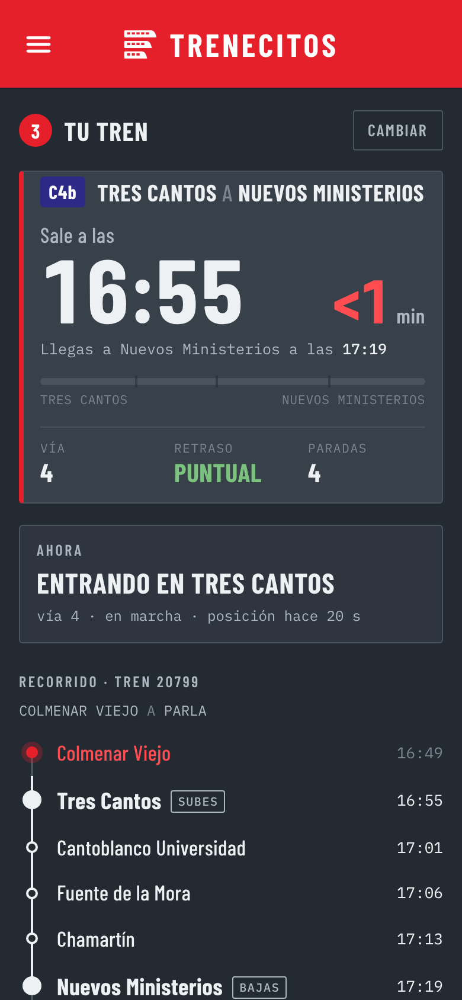

# Trenecitos

¿Llegas al tren? Cercanías Madrid en tiempo real, con los datos abiertos de Renfe.

**[trenecitos.pages.dev](https://trenecitos.pages.dev/)**

  
  
  

## Cómo funciona

1. **¿Cuál es tu viaje?** Guarda los trayectos que haces a diario y elige el sentido.
2. **Elige tu tren.** Los próximos trenes directos con su hora de llegada, retraso, vía y cuenta atrás.
3. **Tu tren.** Síguelo hasta tu parada: cuánto falta para que salga, dónde va, la siguiente parada, cuántas quedan y los avisos de Renfe. Si sales de la app, una notificación te trae de vuelta.

Sin cuentas ni registro: tus viajes se guardan solo en tu navegador.

## Instalarla

Es una aplicación web progresiva (PWA): funciona en el navegador y se puede instalar como una app más.

- **Android (Chrome):** botón *Instalar* en la propia app, o menú ⋮ › *Instalar aplicación*.
- **iPhone (Safari):** Compartir › *Añadir a pantalla de inicio*.
- **Ordenador (Chrome, Edge):** icono de instalar en la barra de direcciones.

## Datos

Información de fuentes abiertas de Renfe Operadora (licencia CC BY 4.0): horarios (GTFS) y tiempo real (GTFS-RT) publicados en [data.renfe.com](https://data.renfe.com). Los horarios se actualizan cada día.

Trenecitos no es una aplicación oficial de Renfe.

## Tecnología

JavaScript sin framework, desplegada en Cloudflare Pages. Una pequeña Function de Cloudflare hace de puente con el tiempo real de Renfe, que no se puede leer directamente desde el navegador.
